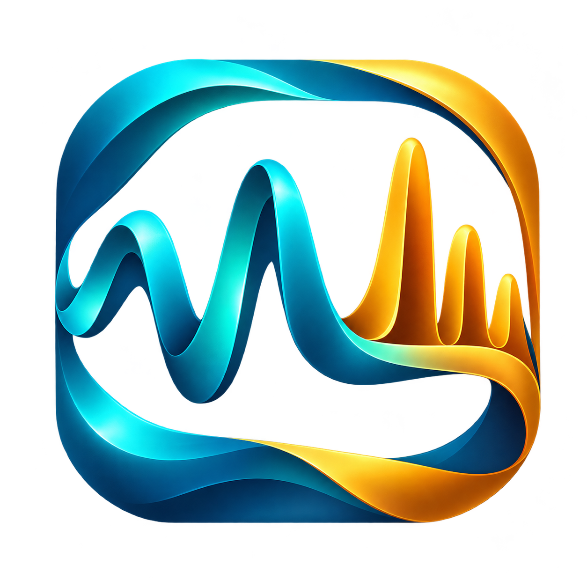

<p align="center">
  
</p>

# Kieran EEG Viewer（脑电查看器）

[](https://github.com/Chihang03/vscode-eeg-viewer/actions/workflows/ci.yml)
[](https://github.com/Chihang03/vscode-eeg-viewer/releases)
[](LICENSE)

由 **Kieran Dai（GitHub：Chihang03；扩展发布者：chihang03）** 独立维护。扩展 ID：`chihang03.kieran-eeg-viewer`。这是一款针对现有采集输出开发的独立工具，不代表采集设备厂商、Microsoft 或第三方机构。

用于在 VS Code 中查看 **SSVEP** 和 **ASSR** 的 EEG 波形与 Welch PSD。默认显示三通道平均波形，可切换为分别显示。安装后无需 Python、服务端或额外运行依赖。

从 [GitHub Releases](https://github.com/Chihang03/vscode-eeg-viewer/releases) 下载 `.vsix` 和 `SHA256SUMS.txt`。使用反馈和功能建议请提交到 [Issues](https://github.com/Chihang03/vscode-eeg-viewer/issues)。版本变化见 [CHANGELOG.md](CHANGELOG.md)。

## 查看文件

安装 VSIX 后，直接打开 `*_eeg.csv`，插件会读取同目录的元数据和事件。也可右键 EEG 文件选择 **EEG：查看波形与 PSD**，或对当前文件使用同名命令。

模式选择仅显示 **SSVEP** 和 **ASSR**，初始值由当前文件结构确定。需要手动指定时，可使用模式下拉框或 **EEG：以 SSVEP 查看** / **EEG：以 ASSR 查看** 命令。

`*_meta.json` 和 `session.json` 可通过「重新打开方式 → EEG 波形与 PSD」查看。其他 CSV 和 JSON 保持原有打开方式。

从 0.1.4 起，插件自带 `*_eeg.csv → kieranEEG.viewer` 默认编辑器关联，安装后无需手动修改设置。该规则比普通 `*.csv` 关联更具体，因此 EEG 文件使用本插件，`trials.csv`、`events.csv` 和其他 CSV 继续由原查看器处理。

默认关联不会写入用户或工作区设置，禁用或卸载插件后随之移除。用户或工作区对同一 `*_eeg.csv` 规则的明确配置优先。规则只依据文件名，不会把任意 CSV 内容判定为 EEG；已打开的文件需关闭后重新打开。

插件从当前文件进入，并关联同一会话中的 trial。左侧可以筛选频率、条件和 trial，或仅查看采集标记有效的记录。

左侧栏默认收起，不占用独立列，点击页面左上方箭头展开或收起。详情面板默认展开，可点击「详情」收起。

两个模式提供分别的入口和浏览内容，共用图表和计算核心；不要求两个项目使用相同的数据组织方式。

## 支持的项目输出

### SSVEP

```text
bigshen_eeg_collection/
  S009/
    sub-S009_20260908_ses-01_28key/
      sub-..._10.2Hz_trial-01_eeg.csv
      sub-..._10.2Hz_trial-01_meta.json
      sub-..._10.2Hz_trial-01_events.csv
      sub-..._10.2Hz_trial-01_display_timing.csv
```

按文件前缀关联 EEG、元数据和事件。频率从 `stimulus.frequency_hz` 读取，支持 0.2 Hz 间隔等小数频率。波形事件使用 `sample_index`；每个 trial 保持独立时间轴。当前版本不加载逐帧 display timing 文件，相关软件时序结论不解释为真实像素点亮时间。

### ASSR

```text
sub-S001_20261012_ses-02_assr/
  session.json
  continuous_eeg.csv
  trials.csv
  events.csv
  audio_manifest.json
```

trial 使用 `trials.csv` 的零基半开区间 `[eeg_start_index, eeg_end_index)`。连续记录、baseline、rest、AM 条件与纯音对照可以分别打开。baseline 和 rest 只使用 `events.csv` 中已经到达的 `*_reached_estimate` 起止边界，按收包时间进行左二分映射；计划或仅提交的阶段不会生成已完成区间。

目标频率读取 `modulation_hz`，同时兼容新输出中的 `left_modulation_hz` / `right_modulation_hz`。`PURE1000` 没有调制目标时不绘制 1000 Hz EEG 目标线。音频文件不是绘图依赖。

## 波形操作

- 波形默认是三通道等权平均：`(FP1 + FP2 + FPz) / 3`，采用较小的图高。任一通道缺失的样本保留为空缺，不临时改为其他通道平均。
- 选择「分别显示」可查看独立通道，切回「三通道平均」恢复紧凑视图。
- PSD 保留各通道的频谱，通道开关也控制分别显示时的波形；隐藏某个通道不改变三通道平均的定义。
- 拖动波形：框选区间，并切换 PSD 到选区。
- 滚轮：以指针为中心缩放时间轴；双击：恢复全段。
- 工具栏支持放大选区、恢复全段、清除选区；底部滑块及左右按钮用于平移。
- `Alt + ←` / `Alt + →`：切换左侧筛选结果中的上一个／下一个区间；`Esc` 清除选区。
- 默认启用「居中显示」：只减去当前视窗均值绘图，不改变参与 PSD 的信号。取消后显示实际信号零点。
- 纵轴可以自动缩放，也可以固定为指定的正负幅度，以便比较 trial。
- 长记录按像素桶保留极值绘图；PSD 始终使用完整样本，不使用绘图抽稀数据。

## PSD 与滤波

PSD 可选择当前 trial／阶段全段、当前可见区间或框选区间。参数包括 2、4、8 秒或全区间单窗，以及 0%、50%、75% 重叠。

在 PSD 图上滚动滚轮，以指针所在频率为中心放大或缩小；按住左键拖动可平移频率轴。双击图表或点击「全频段」恢复 0 Hz 至 Nyquist 频率。初次显示 0–60 Hz（不超过 Nyquist）；切换 trial、通道或显示参数时保留频率视野。放大到细节时显示实际频点，最窄视野为两个频率间隔；缩放只改变显示，不改变 Welch 计算结果或 `Δf`。

算法定义：

- 周期 Hann 窗，逐段去均值，单边密度谱，在线性功率域求平均。
- `nfft = nperseg`，输出不额外补零；任意窗长使用 Bluestein FFT。FFT 内部卷积的补零不改变输出频率网格。
- 多通道使用联合有限区间，分析窗口不会跨越 NaN、空值或无穷值。不同连续片段按实际窗口数加权。
- 连续片段不足请求窗长时缩短窗长并给出提示；不足 16 个连续样本时不显示 PSD。
- 显示实际窗长、频点间隔、平均窗口数及有效样本数。频点间隔不是相邻生理响应可被分开的保证。
- PSD 可显示线性密度，或 `10 log10(PSD / 1 单位²/Hz)`；μV 输入对应 μV²/Hz 和 dB re 1 μV²/Hz。
- 目标频率及其二、三次谐波由当前记录元数据生成参考线。

默认使用原始信号。可选滤波由二阶 Butterworth 高通和二阶 Butterworth 低通串联构成，默认截止频率 0.5 / 60 Hz；另可开启 50 Hz、Q=30 的陷波。滤波以各连续片段为单位，使用奇对称边界延拓、稳态初值和前后向 SOS 零相位处理。先对完整已加载区间滤波，再计算选区 PSD，缩放不会重新定义滤波边界。短于延拓长度的片段会被排除并提示。

「固定为对照 A」保留当时的 PSD、分析参数和处理配置，随后可与其他 trial 叠加。A 显示为虚线，当前数据为实线；单位不同不叠加。可以跨会话比较，界面会显示 A 的来源及处理方式。

## 单位和时间轴

采样率从 `device.sampling_rate_hz` 或 `device.sample_rate_hz` 读取，通道从 `device.channels` 读取。不能缺省推断采样率。

仅当元数据声明 `signal_unit = raw_device_float` 且存在有限非零 `device_to_uv_scale` 时转换为 μV。当前两套数据的换算系数为 -100；未知单位保留为原始单位。单位转换只发生一次。

正常波形采用按元数据采样率构建的 `i / fs` 时间轴。`host_receive_monotonic_ns` 是主机批量接收时间，同批样本可以共用时间戳；它不作为每个样本的设备采样时间。接收时间用 BigInt 解析，避免纳秒整数精度损失。

ASSR 的驱动输出估算和主机收包时间对齐不等同于已经验证的声学同步；SSVEP 主机事件不等同于真实光学刺激起点。「采集标记有效」单独呈现，不替代波形质量或诱发响应判断。

## 导出

- **导出图像**：导出当前波形视窗和 PSD，附会话、信号处理、单位、PSD 来源与窗长说明。
- **导出 PSD**：导出所有通道的完整频率网格及线性密度值。CSV 附带源文件样本起止索引、采样率、窗口、重叠比例、平均窗口数、处理配置和来源；不受当前通道隐藏、频率轴裁剪和 dB 显示影响。

通过保存对话框选择导出路径。原始文件只读访问，没有写回 EEG、事件和元数据的功能。

## 本地开发和验证

在 VS Code 中打开本目录，按 F5 启动扩展开发宿主。Node.js 22+ 可直接运行核心测试；构建发行包时先安装锁定的开发依赖：

```bash
npm run check
npm test
npm ci --ignore-scripts
npm run check:identity
npm run package
```

`@vscode/vsce` 是开发依赖，不随插件分发。`package-lock.json` 固定构建依赖，打包前会自动运行语法、产品身份和核心测试。开发约定见 [CONTRIBUTING.md](CONTRIBUTING.md)，安全反馈见 [SECURITY.md](SECURITY.md)，Logo 说明见 [品牌资产](assets/README.md)。GitHub tag 发布仅生成 GitHub Release，不会发布到 VS Code Marketplace。

可选开发验证依赖 NumPy / SciPy，用户运行插件不需要这些依赖：

```bash
python scripts/verify-scipy.py
node scripts/verify-real.cjs /path/to/bigshen_eeg_collection /path/to/assr/session
```

数值验证包括任意长度 FFT、正弦功率积分、逐频点 SciPy Welch 比对、缺失段窗口权重、单位缩放以及逐样本 SOS 滤波比对。真实数据脚本读取所有会话元数据，并检查代表性 trial 和 ASSR 阶段的切片与 PSD。

当前范围：本地桌面 VS Code，以及在远程工作区扩展宿主上运行的磁盘访问。暂不支持浏览器版 VS Code、设备直连、实时串口采集、EDF/BDF、头皮图、时频图或多 trial 的统计汇总。

为保持浏览响应，单个 EEG CSV 限制为 256 MB / 200 万样本；目录扫描限制为 8 层和 30,000 个条目，缓存最近两份记录。没有跨机器的加载耗时或帧率保证。
